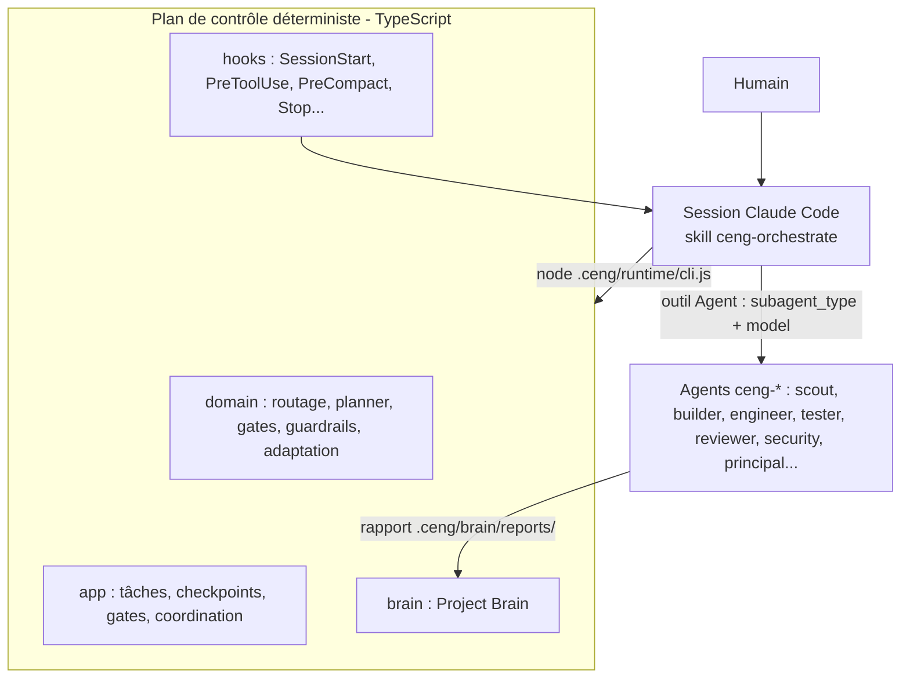

# claude-eng-framework (`ceng`)

Un framework en TypeScript qui transforme une session Claude Code en orchestrateur : routage déterministe des tâches vers le bon modèle, garde-fous par hooks, quality gates et mémoire de projet qui survit à la conversation.

## Problème résolu

Sur un chantier long, une session d'assistant de code pose trois problèmes : le contexte se perd à la compaction ou à la reprise, le choix du modèle et du niveau de réflexion est arbitraire (donc coûteux ou fragile), et « terminé » n'est vérifié par rien. `ceng` déplace ces décisions hors du LLM, dans un moteur de politique testé qui ne consomme aucun token. Le LLM garde le jugement (évaluer une tâche) ; la politique en déduit le modèle, l'effort, la revue, les tests et les gates, et explique son choix.

## Fonctionnalités

- **Découverte du projet** : détection de la pile (Node, Python, Flutter, dbt, Prisma, Supabase, etc.), des commandes réelles de lint/test/build et du niveau de risque. `ceng init` n'écrit jamais dans le code applicatif.
- **Routage expliqué** : `ceng route <tâche>` donne agent, modèle (Haiku, Sonnet ou Opus), effort, revue, stratégie de test, gates et règle d'escalade.
- **Planification du parallélisme** : exécution directe, séquentielle, subagents parallèles ou Agent Team ; deux tâches au même périmètre ne tournent jamais en parallèle.
- **Project Brain** (`.ceng/brain/`) : index court, état, rapports d'agents, checkpoints et décisions (ADR) chargés à la demande ; reprise sans historique de conversation.
- **Hooks Claude Code** : injection de l'état à la reprise, refus des commandes dangereuses ou des lectures de fichiers de secrets, journal des délégations, checkpoint avant compaction et à l'arrêt.
- **Quality gates** : une tâche ne passe à `done` que si ses gates requises sont vertes (ou dérogation justifiée et journalisée), dont un scanner de secrets intégré.
- **Mode sans humain** : `ceng run --unattended` avec limites de durée et de budget ; les actions sensibles sont refusées et consignées dans `pending-approvals.md`.
- **Équipe de sessions** : `ceng team` (permissions tranchées par une liste de sécurité fermée) et `ceng relay` (événements entre sessions).
- **Contenu installable** : 11 agents `ceng-*` et 27 skills dans `core/`, installables seuls via `npx skills add`.

## Architecture



Le code suit des couches strictes (voir [docs/architecture.md](docs/architecture.md)) : `domain/` ne fait aucune I/O, `infra/` n'utilise que Node. Le projet n'a aucune dépendance d'exécution ; le runtime est copié tel quel dans `.ceng/runtime/` du projet cible, ce qui évite toute installation pour les coéquipiers ou la CI.

## Stack

| Élément | Choix |
|---|---|
| Langage | TypeScript 5.9, ESM, `strict` |
| Exécution | Node.js 22 ou plus, sans dépendance d'exécution |
| Tests | Node test runner (`node --test`) |
| CI | GitHub Actions : Ubuntu, Windows, macOS ; Node 22 et 24 |
| Cible | Claude Code (hooks, subagents, skills, Agent Teams) |
| Packaging | CLI `ceng` / `claude-eng-framework` (`bin`), installation depuis GitHub |

## Installation

Prérequis : Node.js 22+, git, [Claude Code](https://code.claude.com/docs/en/setup).

```bash
# 1. Depuis les sources
git clone https://github.com/Jean-Paul15/claude-eng-framework
cd claude-eng-framework

# 2. Dépendances de développement puis build (le script prepare lance tsc)
npm ci

# 3. Rend la commande `ceng` disponible
npm link
```

Sans cloner : `npx github:Jean-Paul15/claude-eng-framework init`, ou `npm install -g github:Jean-Paul15/claude-eng-framework`.
Les skills seules s'installent avec `npx skills add Jean-Paul15/claude-eng-framework -g -a claude-code -y`
(`ceng-orchestrate` et `ceng-skill-forge` requièrent le framework complet).

## Usage

Dans le dossier du projet cible :

```bash
ceng init            # questions : risque, autonomie, budget, parallélisme (--yes : valeurs détectées)
ceng doctor          # vérifie l'installation
ceng run             # ouvre Claude Code en mode orchestrateur (ou /ceng-orchestrate dans Claude Code)
ceng status          # état du projet
ceng route T-0004    # décision expliquée pour une tâche
ceng gate run T-0004 # exécute les gates requises
ceng report          # rapport d'observabilité
ceng run --unattended --max-hours 8 --max-budget-usd 20   # travail sans humain
```

`ceng help` détaille toutes les commandes ; elles acceptent `--json`. Dans un projet initialisé, `node .ceng/runtime/cli.js` remplace `ceng`. Le guide pas à pas (nouveau projet, mode nuit, équipe de sessions, tri des décisions) est dans [docs/usage.md](docs/usage.md).

`ceng init` écrit dans le projet : `.ceng/` (config, profil, Brain, runtime), `.claude/skills/` et `.claude/agents/` selon le profil, `.claude/settings.json` (fusion non destructive avec sauvegarde), un bloc délimité dans `CLAUDE.md` et des exclusions dans `.gitignore`.

## Structure du dépôt

```text
src/
  domain/       politique pure : routage, planner, gates, guardrails, secrets
  discovery/    détection de pile, de plateforme et de risque
  brain/        stockage du Project Brain
  app/          cas d'usage : tâches, checkpoints, gates, coordination
  generation/   installation dans un projet (settings, CLAUDE.md, skills)
  hooks/        gestionnaires des hooks Claude Code
  cli/, cli.ts  interface en ligne de commande
  infra/        fs atomique, verrou, git, exec
core/           agents, skills et catalogue installés dans les projets
test/           suites de tests (une par domaine)
examples/       cinq projets de démonstration servant aux tests de découverte
docs/           documentation détaillée      research/  notes de conception
```

## Tests

```bash
npm test        # build puis node --test sur dist/test
npm run typecheck
```

La suite compte 244 tests en 48 suites (routage, planification, garde-fous, découverte sur les projets de `examples/`, installation, cycle de vie, hooks, reprise après interruption, mode sans humain). Détail dans [docs/validation.md](docs/validation.md).

## Limites connues

- Le framework cible Claude Code ; il n'est pas conçu pour d'autres assistants.
- Les décisions de routage reposent sur l'évaluation de la tâche faite par le LLM (complexité, risque, ambiguïté) : la politique est déterministe, pas son entrée.
- Le mode sans humain refuse les actions sensibles au lieu de les exécuter ; elles attendent une validation ultérieure.
- Le graphe de code dépend de l'outil externe [graphify](https://github.com/Graphify-Labs/graphify), optionnel.
- Les projets de `examples/` sont des fixtures de test, pas des applications complètes.
- Les preuves en conditions réelles décrites dans `docs/validation.md` portent sur une version précise de Claude Code et ne sont pas rejouées par la CI.

## Licence

Apache License 2.0 : voir [LICENSE](LICENSE) et [NOTICE](NOTICE). Copyright 2026 Jean-Paul ADOGLI.

## Contact

Jean-Paul ADOGLI, [github.com/Jean-Paul15](https://github.com/Jean-Paul15).
