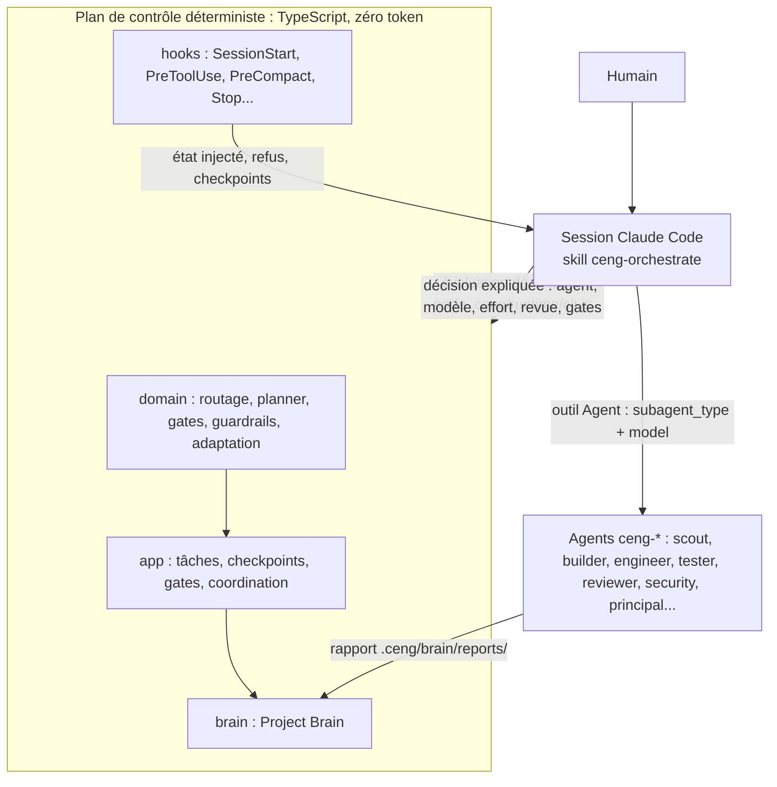

<div align="center">
  <h1>ceng</h1>
  <p><b>Un orchestrateur déterministe pour Claude Code.</b></p>
  <p>
       
  </p>
  <p>
      
  </p>
  <p>
    <a href="#démarrer-en-cinq-minutes">Démarrer</a> ·
    <a href="#comment-ça-marche">Architecture</a> ·
    <a href="#stack-technique">Stack</a> ·
    <a href="#structure-du-dépôt">Structure</a> ·
    <a href="#tests">Tests</a>
  </p>
</div>

`ceng` retire du LLM les décisions qu'il prend mal sur un chantier long (quel modèle, quel effort, quelle revue, quand c'est « fini ») et les confie à un moteur de politique en TypeScript, testé, qui ne consomme aucun token.

## Sommaire

- [Ce que ça apporte](#ce-que-ça-apporte)
- [Le problème](#le-problème)
- [Démarrer en cinq minutes](#démarrer-en-cinq-minutes)
- [Comment ça marche](#comment-ça-marche)
- [Stack technique](#stack-technique)
- [Structure du dépôt](#structure-du-dépôt)
- [Tests](#tests)
- [Limites et suite](#limites-et-suite)
- [Licence](#licence)
- [Contact](#contact)

## Ce que ça apporte

- **Des décisions reproductibles et expliquées.** `ceng route <tâche>` renvoie agent, modèle (Haiku, Sonnet ou Opus), effort, niveau de revue, stratégie de test et gates. Deux sessions qui reçoivent la même évaluation obtiennent la même décision, et chaque décision vient avec ses raisons.
- **Un « terminé » qui se prouve.** Une tâche ne passe à `done` que si ses quality gates requises sont vertes, scanner de secrets intégré compris. Une dérogation est possible, mais elle doit être justifiée et elle est journalisée.
- **Un chantier qui survit à la conversation.** Le Project Brain (`.ceng/brain/`) garde l'état, les checkpoints et les décisions sur disque. Après une compaction ou une coupure, la reprise n'a besoin d'aucun historique de conversation.

## Le problème

Vous confiez à un assistant de code une migration qui dure plusieurs jours. À la compaction, il oublie pourquoi il a écarté une piste. Il lance Opus pour renommer une variable, puis Haiku pour un webhook de paiement. Il déclare la tâche terminée parce que « ça compile ». Aucun de ces trois défauts n'est un bug du modèle : ce sont des décisions laissées à un système qui n'a ni mémoire durable ni règle écrite. `ceng` écrit ces règles, les exécute hors du LLM et ne lui laisse que le jugement : évaluer la tâche (complexité, risque, ambiguïté).

## Démarrer en cinq minutes

Prérequis : Node.js 22 ou plus, git, [Claude Code](https://code.claude.com/docs/en/setup).

```bash
git clone https://github.com/Jean-Paul15/claude-eng-framework
cd claude-eng-framework && npm ci    # installe les outils de développement et compile (script prepare)
npm link                             # rend la commande ceng disponible
cd /chemin/vers/mon-projet && ceng init    # questions : risque, autonomie, budget (--yes : valeurs détectées)
ceng run                             # ouvre Claude Code en mode orchestrateur
```

`ceng doctor` vérifie l'installation, `ceng status` donne l'état du projet, `ceng help` liste toutes les commandes (elles acceptent `--json`). `ceng init` n'écrit jamais dans le code applicatif : il crée `.ceng/`, des agents et skills sous `.claude/`, fusionne `.claude/settings.json` avec sauvegarde, ajoute un bloc délimité dans `CLAUDE.md` et des exclusions dans `.gitignore`. Le guide pas à pas (cahier des charges, bypass total, mode nuit, équipe de sessions, tri des décisions) est dans [docs/usage.md](docs/usage.md). Les outils d'économie de jetons du moment (Graphify, RTK, Ponytail) sont comparés à ce que ceng fait déjà dans [docs/economie-tokens.md](docs/economie-tokens.md).

## Comment ça marche



Trois choix structurent le code.

**Le jugement et la politique sont séparés.** Le LLM évalue la tâche, `src/domain/routing.ts` en déduit la décision. La fonction est pure : même entrée, même sortie, testable sans modèle. Quand le risque l'exige (un domaine critique comme les paiements), des planchers s'imposent même en mode économie.

**Les garde-fous sont des hooks, pas des consignes.** Un prompt demande au modèle d'être prudent. Un hook `PreToolUse` refuse la commande. `src/domain/guardrails.ts` classe chaque action en autonome, soumise à approbation ou interdite. Le code le dit lui-même : c'est une défense en profondeur, pas un sandbox, et une commande obfusquée peut passer.

**Zéro dépendance d'exécution, runtime copié dans le projet.** `ceng init` place le runtime tel quel dans `.ceng/runtime/`. Les coéquipiers et la CI n'installent rien. Les écritures sont atomiques (`src/infra/fs.ts`) et les sections critiques passent par un verrou (`src/infra/lock.ts`), parce que plusieurs sessions peuvent écrire dans le Brain. Le détail des couches est dans [docs/architecture.md](docs/architecture.md).

## Stack technique

| Domaine | Technologies | Rôle dans le projet |
|---|---|---|
| Langage |  | TypeScript 5.9, ESM, mode `strict` |
| Exécution |  | Node.js 22 ou plus, sans dépendance d'exécution |
| Tests |  | `node --test`, 399 tests en 100 suites d'après [docs/validation.md](docs/validation.md) |
| Intégration continue |  | Ubuntu et Windows ; Node 22 et 24 |
| Cible |  | Hooks, subagents, skills, Agent Teams |
| Packaging |  | CLI `ceng` ou `claude-eng-framework` (champ `bin`), installation depuis GitHub |
| Documentation |  | Schéma d'architecture ci-dessus, détail dans `docs/` |

## Structure du dépôt

```text
src/
  domain/       politique pure, sans I/O : routage, planner, gates, guardrails, secrets
  discovery/    détection de pile, de plateforme et de risque
  brain/        stockage du Project Brain
  app/          cas d'usage : tâches, checkpoints, gates, coordination, mode sans humain
  generation/   installation dans un projet (settings, CLAUDE.md, skills)
  hooks/        gestionnaires des hooks Claude Code
  cli/, cli.ts  interface en ligne de commande
  infra/        fs atomique, verrou, git, exec
core/           11 agents ceng-* et 27 skills installés dans les projets
test/           suites de tests, une par domaine
examples/       cinq projets de démonstration (web, API, data, mobile, bibliothèque TS)
docs/           documentation détaillée
research/       notes de conception
```

## Tests

Pour lancer les tests : `npm test` (build puis `node --test`). Pour le typage seul : `npm run typecheck`.

## Limites et suite

Le périmètre est un choix : `ceng` fait une chose, cadrer Claude Code, et la fait en profondeur.

- **Cible unique.** Hooks, subagents et skills de Claude Code. Les autres assistants sont hors périmètre.
- **Politique déterministe, entrée venue du LLM.** Le routage reproduit la même décision pour la même évaluation. L'évaluation de la tâche, elle, vient du LLM.
- **Prudence en mode sans humain.** `ceng run --unattended` (avec `--max-hours` et `--max-budget-usd`) refuse les actions sensibles et les consigne dans `pending-approvals.md` pour validation ultérieure.
- **Graphe de code optionnel.** Il s'appuie sur l'outil externe [graphify](https://github.com/Graphify-Labs/graphify).
- **Preuves réelles ciblées.** [docs/validation.md](docs/validation.md) décrit des essais sur une version précise de Claude Code. La CI ne les rejoue pas.
- **Exemples = fixtures.** Les projets de `examples/` servent aux tests de découverte, pas de vitrine applicative.

Pour prolonger le projet, [docs/extending.md](docs/extending.md) explique comment ajouter agents et skills, chaque ajout passant par un test.

## Licence

Apache License 2.0 : voir [LICENSE](LICENSE) et [NOTICE](NOTICE). Copyright 2026 Jean-Paul ADOGLI.

## Contact

Jean-Paul ADOGLI, [github.com/Jean-Paul15](https://github.com/Jean-Paul15).
